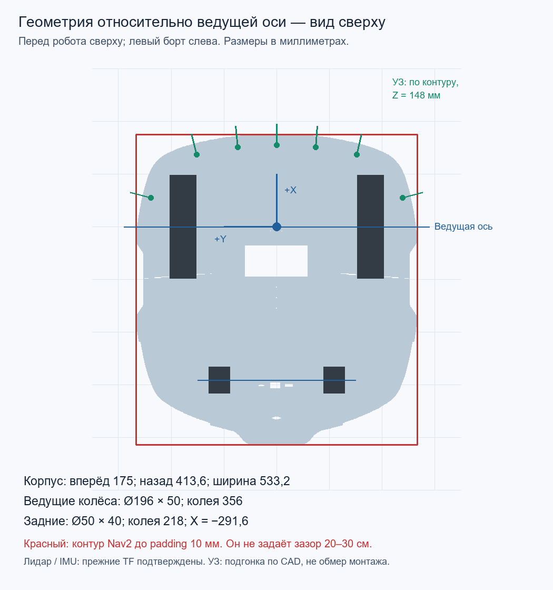

# Геометрия, TF и footprint

Корпус из STEP подключён в `verter_description/urdf/verter_robot.urdf`. Аппаратный launch выбирает эту модель. `verter_robot_minimal.urdf` не используется штатным запуском.

## Подтверждённая геометрия

- Ведущие колёса Ø196×50 мм, колея 356 мм; центры x=0,y=±178,z=98 мм от пола.
- Два задних опорных Ø50×40 мм, колея 218 мм; центры x=−291.629,y=±109,z=25 мм. Отступ от заднего края 122 мм. Крепления и поворотные механизмы пока не моделируются.
- Корпус по выровненному CAD: X от−413.629 до+175 мм, Y±266.577 мм. Нижний край 50 мм от пола. Высота выбранной CAD-группы 560.417 мм. Масштаб STL — метры, scale 1.
- `base_footprint`: на полу под серединой ведущей оси; `base_link`: x=y=0,z=100 мм. Ведущие колёса относительно него z=−2 мм. 
- Collision корпуса — охватывающий CAD параллелепипед, visual — mesh. Массы и инерции не заданы: это не модель динамической симуляции.

## Контур Nav2

В local/global costmap используется одинаковый охватывающий прямоугольник:

```yaml
footprint: "[[0.175, 0.267], [-0.414, 0.267], [-0.414, -0.267], [0.175, -0.267]]"
footprint_padding: 0.01
```

Размеры округлены наружу, колёса укладываются внутри. Это начальный консервативный контур известного корпуса, включая пустые углы округлой формы. Он не доказывает отсутствие выступающих частей, которых нет в предоставленном CAD.

Padding 10 мм — геометрический запас; желаемые 20–30 см до препятствий он НЕ реализует. Inflation сохранена 0.40 м и также не является строгой гарантией зазора. Настройка поведения и скорости относится к этапу проверки навигации.

NavFn не делает полноценную проверку формы во всех ориентациях: polygon в costmap не устраняет это ограничение планировщика. Для тесных поворотов потребуется проверка и, при необходимости, планировщик с учётом ориентации робота. 

## Датчики — согласованная привязка

Лидар и IMU используют фиксированные TF. Центры УЗ размещены у края CAD-корпуса на высоте 148 мм. XYZ УЗ ниже получены по CAD, а не измерением установленных датчиков.

| Frame | X, Y, высота от пола, мм | Угол yaw |
|---|---|---|
| lidar_link | 0,0,860 | 0° |
| imu_link | 0,0,405 | 0° |
| sensor_front_center | 155,0,148 | 0° |
| sensor_front_left/right_inner | 150.9,±74,148 | ±5.7° |
| sensor_front_left/right_outer | 136.9,±152,148 | ±13.2° |
| sensor_left/right | 55,±239,148 | ±75.9° |
| camera_link | −33,0,650 | 0°; публикует отдельный сервис Gemini 2 |

Метод: горизонтальное сечение STL на высоте 148 мм от пола (98 мм над нижней точкой mesh), затем выпуклая оболочка его внешнего контура. Оболочка перекрывает отверстия под датчики. Передняя панель на этой высоте находится примерно в 155 мм перед ведущей осью, то есть на 20 мм глубже крайней точки бампера 175 мм. Сохранены исходные поперечные позиции пяти передних датчиков. Боковые остаются на 100 мм позади переднего центрального, а их Y подогнан к боковому контуру. Левые/правые пары симметричны, координаты округлены до 0.1 мм; такая запись не означает точность физического монтажа 0.1 мм.

URDF использует для них Z=0.048 относительно base_link, то есть 0.148 от пола. Подтверждённые углы сохранены. Зелёные маркеры обозначают согласованную подгонку. Размеры самих датчиков показаны условными кубиками 20 мм.

Воспроизведение: `python3 tools/fit_ultrasonics.py` печатает координаты; `--apply` обновляет только URDF и geometry.json проекта. Измерения УЗ подключены к Nav2 через адаптер массива и RangeSensorLayer; протокол и ограничения свежести описаны в [COSTMAP.md](COSTMAP.md). Физическая проверка индексов и конусов остаётся необходимой.



## Просмотр без оборудования

Из корня проекта после сборки, в свободном отдельном ROS-домене:

```bash
source tools/env.sh
export ROS_DOMAIN_ID=178 ROS_LOCALHOST_ONLY=1
ros2 launch verter_description view.launch.py
```

Запускаются только robot_state_publisher и RViz, Fixed Frame=base_footprint. Для запуска без GUI добавить `gui:=false`. Не запускать этот publisher в домене действующей аппаратной системы одновременно с её robot_state_publisher.

## Проверка модели

`tests/test_geometry.py`: дерево URDF, контакт четырёх колёс с полом, отступ задних колёс, охват STL контуром Nav2, одинаковые параметры costmap, сохранность TF лидара/IMU, высота и положение семи УЗ у контура.

`tests/integration_geometry.py`: реальный robot_state_publisher в домене 178, чтение четырнадцати TF, отсутствие command/sensor publishers. `tests/integration_modes.py`: Nav2 принимает заданный polygon при реальном цикле переключений на искусственных датчиках. Аппаратная приёмка остаётся отдельной.

Модель не заменяет физическое измерение монтажа датчиков. Камера публикует `base_footprint → camera_link → camera_depth_optical_frame` и заводской TF цветной камеры. Оставшиеся URDF frames `camera_tof`/`camera_tof_optical` не используются сообщениями Gemini 2; их визуальный маркер не обозначает фактическую установку Gemini 2. Подробности — [CAMERA_API_V1.md](CAMERA_API_V1.md).

Источники: https://docs.nav2.org/rolling/configuration_and_development/first_time_robot_setup_guide/footprint/setup_footprint/ и https://docs.nav2.org/rolling/configuration_and_development/tuning_guide/ .

M10P: TF `lidar_link` имеет yaw=0; задний сектор `/scan` исключается в
`config/laser_filters/m10p_filter.yaml` пакета `verter_bringup`: π ± 0,7 рад
(около 80°). `/scan_raw` не фильтруется. Ориентацию нужно подтвердить по известному
препятствию впереди робота; зеркальная перестановка массива дальностей не используется.
